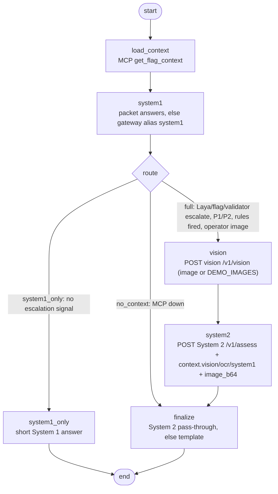

# SPOT orchestrator (LangGraph), port 8085

One service, two LangGraph graphs, everything over HTTP (no database, no model weights):

- **`POST /v1/assess`**: the deterministic per-flag pipeline. It loads MCP context, gets System 1 (Laya) answers,
  routes (System 1 -> System 2), runs vision/OCR when there is an image, calls System 2, and finalizes with the
  template fallback. The model never calls tools here.
- **`POST /v1/ask`**: a new chat path. The System 2 model (gateway alias `system2`) can call the read-only MCP tools
  in a bounded loop (at most 4 calls, 30 s).

Spec: [`docs/orchestrator-contract.md`](../../docs/orchestrator-contract.md). Integration steps (compose, env, backend
change): [`INTEGRATION.md`](INTEGRATION.md).

## Assess graph

`GET /v1/graph` returns the live mermaid for both graphs (`?format=text&graph=assess|ask` for the bare text).

**Routing rule (System 1 -> System 2).** The full path runs when any of these hold: Laya `escalate=A`, Laya
priority P1/P2, the flag is escalated or P1/P2, the validator says escalate or P1/P2, a policy rule fired, or the
operator attached an image. Otherwise the flag gets the short System 1 answer, and System 2 is not called. Every
reason that fired is listed in `route_reasons`.

Stored flags are already escalated at ingest (the backend runs Laya + the rules on every event, and only escalated
events become flags), so for a stored flag `flag_escalated` almost always fires. The System 1 -> System 2 routing
saving happens **at ingest**: routine events never become flags. `system1_only` here applies to un-escalated items
(a routine flag made by hand, a prefetched `context` for an event that was not escalated, a de-escalated flag).

**Budgets.** There is a global deadline (`ORCH_DEADLINE_S`, 40 s: under the backend's 45 s `REQUEST_DEADLINE_S`, so
the backend can still store the answer) plus per-node budgets: context 15 s (at most 40 % of the deadline), System 1
6 s, vision 12 s, System 2 20 s (System 2's own 15 s generation deadline plus its checks). When an image is sent,
System 2 gets `ORCH_SYSTEM2_IMAGE_BUDGET_S` 28 s (its `SYSTEM2_IMAGE_DEADLINE_S` 25 s plus checks) and vision is
capped so that budget stays free (at least 3 s for vision). The full chain is in the contract ("Timeout chain")
and `docs/RUNNING.md` "Timeouts and keys". Each node is capped by the time left. A node with no
time left is skipped, and the request still ends with the template. Each node writes one `trace` entry:
`{node, ms, status, detail}`.

**Grounding.** System 2 enforces grounding, and its reply passes through unchanged. Vision numbers come from the
vision service's code readers; they become `V#` rows with `trust: HIGH` when `confidence >= 0.5` (never for
`AMBIGUOUS_NEEDLE`/`DEFAULT_SWEEP`), carry the reader's `flags`, and `bound: "lower"` for `CLIPPED`. Only rows the
vision service produced in this request are sent: `vision`/`ocr` in the packet or a caller's `context` are dropped.
A demo image (`DEMO_IMAGES=1`) is a kit sample, not this asset: no logged reading is sent with it, its rows carry no
comparison, and its alert is returned as `vision.demo_alert`. The template uses only packet values; it never prints
a LOW-trust value, labels each comparison `agrees` / `disagrees` / `not judged`, and cites HIGH `linked` rows only.
When System 2 answers with its own checked template (`path` `fallback`/`insufficient_context`), `source` is
`system2_template`.

## Ask graph
```
START -> agent -?-> tools -> agent ...   (<= 4 allowlisted search_*/get_* MCP calls, then one tool-less turn)
               \-> fallback_retrieve -> answer_from_context -> finish   (no tool call / tool calling failed)
               \-> finish -> END
```
**Tool calling needs `--jinja`.** llama-server needs `--jinja` for Qwen tool calling, for example
`llama-server -m qwen3.5-9b-q4_k_m.gguf --jinja ...`. Without it, the request with `tools` fails or returns
plain text, and the orchestrator degrades: it runs one retrieval step itself (`search_spot_manual`, `search_policy`,
and `get_flag_context(flag_id)` or `search_similar_incidents`) and asks the model to answer from those results
(`mode: "retrieval_fallback"`). If the model is down, the answer lists the retrieved sources verbatim
(`mode: "no_model"`). `citations` lists only ids the answer cites as whole `[id]`/tokens (`[]` and `cited: false`
when it cites none); `retrieved` lists every id the tools returned.

## Environment
All configuration comes from env vars. The full table is in the contract ("Environment"). The essentials:

| Var | Default |
|---|---|
| `ORCHESTRATOR_API_KEY` (required, >= 16 chars; `ORCHESTRATOR_ALLOW_NO_AUTH=1` for tests only) | none |
| `MCP_URL`, `MCP_AUTH_TOKEN` | `http://localhost:8090/mcp`, unset |
| `GATEWAY_URL`, `GATEWAY_KEY` (falls back to `LITELLM_MASTER_KEY`) | `http://localhost:4000`, unset |
| `VISION_URL` (empty = no vision), `VISION_API_KEY` (the vision service requires it) | `http://localhost:8084`, unset |
| `SYSTEM2_URL` (empty = template only), `SYSTEM2_API_KEY` | `http://localhost:8083`, unset |
| `DEMO_IMAGES`, `DEMO_IMAGES_DIR` | `0`, `web/public/kit/inspection` (checkout) / `/app/demo-images` (image) |
| `ORCH_DEADLINE_S`, `ASK_DEADLINE_S`, `ASK_MAX_TOOL_CALLS` | `40`, `30`, `4` |
| `ORCH_SYSTEM2_BUDGET_S`, `ORCH_SYSTEM2_IMAGE_BUDGET_S` | `20`, `28` |

## Run natively (AMD Jupyter VM, no root/Docker)
```bash
cd amd/orchestrator
python3 -m venv .venv && .venv/bin/pip install -r requirements.txt
export ORCHESTRATOR_API_KEY=$(python3 -c "import secrets; print(secrets.token_urlsafe(24))")
export MCP_URL=http://127.0.0.1:8090/mcp GATEWAY_URL=http://127.0.0.1:4000 GATEWAY_KEY=$LITELLM_MASTER_KEY \
       VISION_URL=http://127.0.0.1:8084 SYSTEM2_URL=http://127.0.0.1:8083 SYSTEM2_API_KEY=$SYSTEM2_API_KEY
.venv/bin/python -m orchestrator          # 127.0.0.1:8085 (ORCHESTRATOR_HOST / ORCHESTRATOR_PORT)
```

## Docker
```bash
docker build -t spot-orchestrator amd/orchestrator
docker run --rm -p 127.0.0.1:8085:8085 -e ORCHESTRATOR_API_KEY=$ORCHESTRATOR_API_KEY \
  -e MCP_URL=http://host.docker.internal:8090/mcp -e SYSTEM2_URL=http://host.docker.internal:8083 spot-orchestrator
```
The image runs as non-root user 10001 and has a HEALTHCHECK on `/health`. In compose it is the `orchestrator`
service (see `INTEGRATION.md`).

## Example calls
```bash
K="X-API-Key: $ORCHESTRATOR_API_KEY"
curl -s localhost:8085/health?deep=true | jq
curl -s -H "$K" -H 'content-type: application/json' localhost:8085/v1/assess -d '{"flag_id": 42}' \
  | jq '{route, route_reasons, source, answer, recommended_action, fallback_reason, trace}'
# with an inspection image (operator upload -> pairing "linked")
curl -s -H "$K" -H 'content-type: application/json' localhost:8085/v1/assess \
  -d "{\"flag_id\": 42, \"image_b64\": \"$(base64 < web/public/kit/inspection/thermal_pump_bearing_01.jpg | tr -d '\n')\"}" \
  | jq '.vision.rows, .answer'
curl -s -H "$K" -H 'content-type: application/json' localhost:8085/v1/ask \
  -d '{"question": "What does the Spot manual say about docking at low battery?", "max_steps": 3}' | jq
curl -s 'localhost:8085/v1/graph?format=text&graph=assess'
```

## Tests (offline)
```bash
.venv/bin/pip install -r requirements-dev.txt && .venv/bin/python -m pytest
```
The tests use fake MCP, gateway (System 1 + System 2 chat through the real `ChatOpenAI`), vision, and System 2
behind httpx MockTransports. They cover routing branches, vision skipped without an image, demo-image mapping, the
System 2 failure -> template path, deadlines, the ask-loop step cap and its no-tool-call fallback, and auth. Two
contract tests run the orchestrator's request against the real System 2 app (stub mode, in-process) and the real
System 1 event schemas. They are skipped when those folders are absent. `tests/test_audit_fixes.py` covers the
2026-10-10 audit fixes (demo pairing, template vision lines, stripped caller rows, reader flags, image budget,
`system2_template`, ask citations, `image_kind`).
